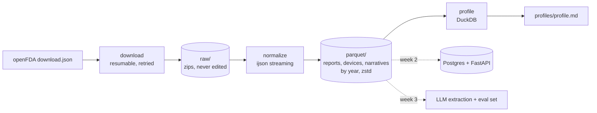

# LotCheck engine

A data pipeline that turns FDA's public medical device adverse event reports (26.5 million+ in openFDA) into fast, queryable tables, starting with continuous glucose monitors (CGMs) and their lot numbers.

> Working name. This is week 1 of a 6-week build: see [docs/plan.md](docs/plan.md).

## Why

FDA's adverse event database (MAUDE) records device problems, but its search can't answer simple questions like "how many reports mention this sensor lot?" The data has real problems to solve, too: about 1 in 3 CGM device entries has no usable lot number (blank, or placeholders like `NI` and `ASKU`), and most narratives are repeated manufacturer templates. Details in [docs/data-notes.md](docs/data-notes.md).

## What week 1 does

- Reads openFDA's download manifest and downloads only the partitions you ask for: resumable, retried, verified.
- Streams each zip record by record into Parquet tables (reports, devices, narratives, recalls, product codes), partitioned by year.
- Cleans lot numbers (real vs blank vs placeholder) and fingerprints narratives to find duplicate templates.
- Profiles everything with DuckDB and writes `data/profiles/profile.md`, with every query timed.

## Architecture



## Quickstart

```bash
python -m venv .venv
source .venv/bin/activate          # Windows: .venv\Scripts\activate
pip install -e ".[dev]"
pytest -q                          # 40 tests, all should pass

lotcheck manifest --since 2025     # file count and size before downloading anything
lotcheck run --since 2025          # one recent year of CGM reports, end to end
```

Then open `data/profiles/profile.md`. For the full CGM history (a much bigger download, so check `lotcheck manifest --since 2006` first):

```bash
lotcheck run --since 2006 --include-undated
```

Interrupted? Run the same command again. Finished downloads and processed files are skipped.

## Commands

| command | what it does |
| --- | --- |
| `lotcheck manifest` | Show files, size and record counts per dataset |
| `lotcheck download --dataset device/event --since 2024` | Download partitions (resumable, `--dry-run` to preview) |
| `lotcheck normalize --product-codes cgm` | Stream zips into Parquet (`all` or `QBJ,PQF` also work) |
| `lotcheck profile` | Run the DuckDB profile and write `data/profiles/profile.md` |
| `lotcheck run --since 2025` | All of the above in one go |

On Windows without `make`, use `python -m lotcheck ...`.

## Data layout

```
data/
  raw/                          zips exactly as FDA serves them, plus .ok markers
  parquet/
    reports/year=2025/*.parquet
    devices/year=2025/*.parquet
    narratives/year=2025/*.parquet
    recalls/recalls.parquet
    classification/classification.parquet
  state/
    normalize_events.json       which zips were processed, with which filter
    runs.jsonl                  one line of metrics per run: your numbers log
  profiles/profile.md
```

## Design decisions

- **Immutable raw layer.** Everything downstream can be deleted and rebuilt from `raw/`.
- **Streaming parse.** `ijson` reads one record at a time, so memory stays flat however large a file is (about 200 MB peak in a 400k-record test).
- **Parquet partitioned by year.** Compact on disk and fast to scan; filtering by year skips whole folders.
- **Idempotent per source file.** Reprocessing a zip deletes exactly its previous output first, so reruns never duplicate rows. A state file makes reruns incremental.
- **Robust downloads.** HTTP Range resume, exponential backoff, no retries on 404, zip verification, `.ok` markers.
- **Auditable cleaning.** Raw lot values are kept next to cleaned ones, with a status and a format "shape" (`T60002615` -> `A1D8`).

## Caveats

MAUDE reports are unverified, can be duplicated, and come without denominators (nobody publishes how many sensors each lot shipped). Counts are not failure rates. Nothing here is medical advice.

## License

MIT
